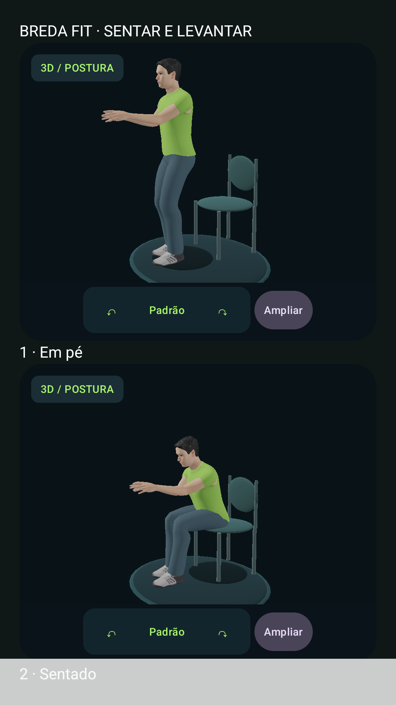
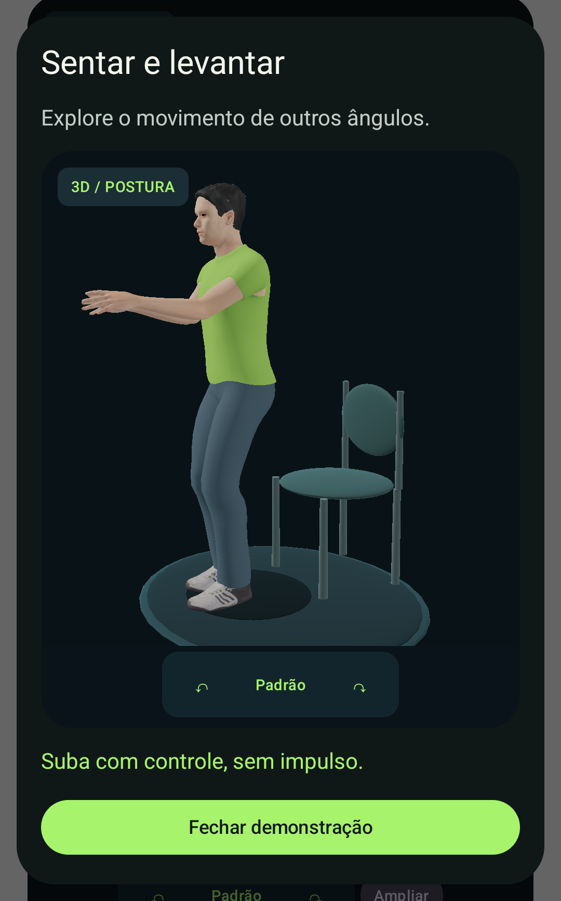

# Breda Fit

**Exercícios em casa e acompanhamento corporal com núcleo Kotlin Multiplatform e interface Android.**

Projeto de **Bruno Breda · breda_dev**. Organizar rotinas educativas, acompanhar sessões e registrar medidas sem inventar calorias, diagnósticos ou resultados de emagrecimento.

**Plataforma:** Android · Compose · núcleo Kotlin Multiplatform  
**Estado:** implementação de portfólio em evolução; esteira aprovada na execução referenciada.

[Fluxos e demonstração](docs/fluxos.md) · [Engenharia](docs/engenharia.md) · [Builds e evidências](docs/evidencias.md) · [Portfólio completo](https://github.com/brunobredadeveloper/breda-park-wash/blob/main/docs/portfolio-breda-dev.md)

## O que você pode avaliar

- Quatro rotinas e doze movimentos, com preparação, exercício, descanso e resumo.
- Tempo monotônico, pausa em segundo plano e histórico persistente.
- Registro de medidas, gráficos por data real e exportação CSV.
- Nome social/preferido, identidade opcional e avatares Caio, Aurora e Alex independentes do gênero.

## Telas reais

Capturas de componentes 3D em testes nativos no emulador Android, recuperadas dos artefatos da esteira. Não representam uma jornada completa pelas telas do app. Não são mockups nem fotografias de um aparelho físico. A origem e os limites estão em [evidências](docs/evidencias.md).




## Fluxo principal

1. Crie um perfil de teste e escolha frequência e meta.
2. Selecione uma rotina e consulte as instruções dos movimentos.
3. Inicie sessão, pause e envie o app ao segundo plano; o tempo deve pausar.
4. Conclua a sessão e consulte o histórico.
5. Registre uma medida e altere o avatar pelo perfil.

## Executar e validar

JDK 17, Android SDK 37 e build-tools 36.0.0; Android 8+. Conversor de assets exige Python 3 e rede no primeiro uso.

```sh
python3 tools/human/build_model.py
./gradlew :shared:jvmTest :androidApp:lintDebug :androidApp:assembleDebug
```

Configuração, Firebase quando aplicável, assinatura e comandos adicionais: [referência técnica](docs/referencia-tecnica.md).

[Abrir a execução verificada no GitHub Actions](https://github.com/brunobredadeveloper/breda-fit/actions/runs/38455184400). A conclusão dessa execução é **success**; consulte os artefatos e a revisão de código em [evidências](docs/evidencias.md).

## Limites do produto

Interface iOS não implementada; targets KMP não comprovam app iOS. Rotinas precisam de revisão profissional antes de publicação comercial. O conceito fotorrealista não foi integrado; as capturas mostram o 3D real atual, com ativos CC0 e limitações descritas.

## Para quem revisa o portfólio

Pessoas adultas e equipes que avaliam domínio compartilhado, sessões e gráficos mobile. As [decisões de engenharia](docs/engenharia.md) conectam responsabilidades, arquivos e testes. O [roteiro funcional](docs/fluxos.md) ajuda a avaliar comportamento, falhas e preservação de dados. Funcionalidade planejada não é apresentada como implementada.

## Próximos passos

- Validar os percursos no dispositivo real e registrar os resultados.
- Revisar acessibilidade, interrupções e falhas de armazenamento/rede aplicáveis.
- Concluir requisitos de distribuição, suporte e segurança antes de uso comercial.

Código, mídias e dependências mantêm seus respectivos termos. Consulte os créditos e os avisos existentes no repositório.
